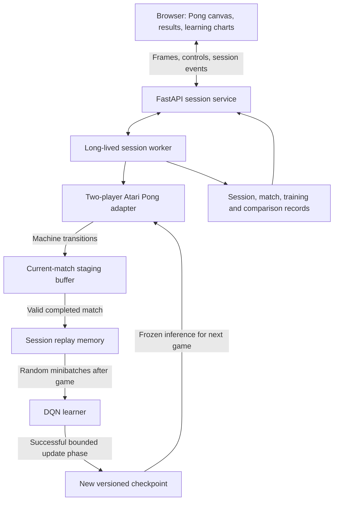
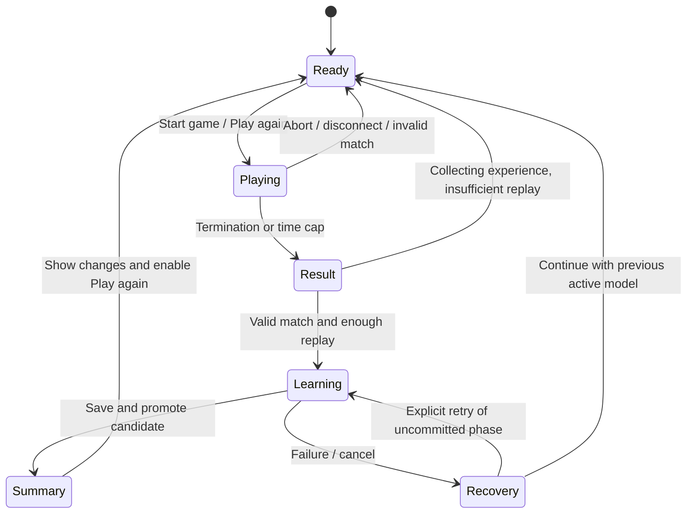

# Pong: play, learn and play again

**Draft v0.2. Implemented (see [README.md](README.md#current-status)); formal approval not yet recorded.
On Windows the two-player Atari runtime runs under WSL2.**

This revision supersedes the broader four-screen v0.1 proposal. The primary demo
is one live Pong match between the user and the DQN, followed by a visible learning
phase and another match using the updated model. [REQUIREMENTS.md](REQUIREMENTS.md)
defines acceptance; [README.md](README.md) is the project entry point.

## 1. The experience to build

1. Start a session with a new model or an explicitly selected compatible model.
2. Play Pong: the user controls one paddle and the DQN controls the other.
3. End the game and show scores, model version and comparison with the last game.
4. Automatically learn from replay after the completed game; show real training
   progress, loss, TD error, Q-values and the changes to the model.
5. Save the updated model and enable **Play again**.
6. Repeat with the same learner and accumulated experience, building a game history.

For this proposal, **one game means a full match**, ending on the environment's
termination or a configurable simulation-time cap, proposed default 120 seconds.
A point or rally does not trigger training. A time-capped, otherwise valid match
is eligible for learning; an aborted or invalid match is not.

## 2. What changes from the previous proposal

| Decision | v0.2 proposal |
| --- | --- |
| Demo game | Pong only |
| Competition | Human and machine control opposing paddles in the same match |
| Learning schedule | Collect during the game; optimize only after it ends |
| Dataset | Machine experience generated by human-versus-machine matches |
| Interface | One connected Play -> Result -> Learning -> Play again flow |
| Comparison | Current and previous match, model versions and session trends |
| Algorithm | Vanilla DQN with replay and a target network |
| Deferred | Double DQN, imported datasets, multi-game UI and paper-benchmark dashboard |

The original paper and supplied Deep Q Learning lesson remain the algorithmic
references for CNN-based Q-values, experience replay, bootstrapped targets and
periodic target copies. This after-match, human-opponent schedule is a demo
adaptation; it has its own protocol rather than inheriting the paper's benchmark.
The supplied references are the workspace's `../docs/Deep Q Learning.pdf`
(the [Hugging Face lesson](https://huggingface.co/learn/deep-rl-course/en/unit3/deep-q-algorithm))
and `../docs/nature14236 (3) (1).pdf` (the Nature DQN paper). These files are outside
this checkout and are not required to run a fresh clone.

## 3. Existing code and the new environment adapter

Reuse the current model, learner, replay, optimizer, checkpoint and preprocessing
code in `src/dqn_project`. Existing single-agent CLI workflows and the Pygame arena
remain available as separate existing tools.

The current arena runs separate single-agent rounds and does not train after
them. The new demo requires a two-player adapter and a session-learning controller.
Use the [PettingZoo Atari Pong environment](https://pettingzoo.farama.org/environments/atari/pong/)
through its [parallel API](https://pettingzoo.farama.org/api/parallel/), which accepts
one action per player for each shared environment step. A small compatibility
probe will verify the chosen installed version, player-side mapping, controls,
frame-skip behavior, scoring and termination before UI integration.

The adapter owns these rules:

- Fix human and machine sides for a session; display the mapping in the UI.
- Resolve action meanings from the installed environment, and map browser
  movement/serve controls through that version's verified action map.
- Apply action repeat exactly once. Target 60 emulator frames/s and four frames
  per decision, giving 15 decisions/s; measure actual cadence and frame counts.
- Max-pool the last two raw frames, resize grayscale to 84x84, stack four frames
  for the machine, and stream RGB to the human's game canvas.
- Preserve per-player rewards, real termination and time-limit truncation.

The [official multi-agent Pong description](https://ale.farama.org/multi-agent-environments/pong/)
includes a penalty for failing to serve. Display engine-reported rewards and
scoring events separately; do not infer the human's return as the negative of
the machine's return. The adapter's tested scoring logic must distinguish goals
and serve penalties. If a point counter cannot be verified, label the scoreboard
as per-player accumulated environment reward rather than inventing goal counts.
If only returns are verified, mark goal/penalty counters unavailable and label the
result **return leader** (higher return; equal returns are a draw), rather than
claiming a verified game winner. This fallback is acceptable for v1 and is visible
in the match protocol, comparison table and saved result.

The published single-agent `ALE/Pong-v5` checkpoint is not automatically compatible
with this two-player environment. Checkpoint compatibility includes environment
family/version, action meanings, player side and preprocessing, not just output
dimension. Reject incompatible imports; randomly initialize the default new session.

## 4. Components and data flow

**Proposed stack:** a local FastAPI service and React/TypeScript/Vite UI. These
services/dependencies remain proposed until approval and implementation.



Retain four internal responsibilities, rather than four independent user journeys:

| Module | Responsibility in the loop |
| --- | --- |
| Experience | Collect, preprocess and validate machine transitions from each match |
| Learning | Run bounded DQN updates after the game; retain replay and learner state |
| Comparison | Record results, compute previous-game deltas and plot session trends |
| Play/UI | Control both players, render Pong and present each learning cycle |

The server owns scoring, model versions and job state. UI values come from real
events/artifacts. A long-lived child worker owns environment and learner state;
the API remains responsive, and only one session is active on the local machine.

## 5. Session state and model lifecycle



- Freeze inference weights and the match epsilon at game start. No gradient
  updates occur during play. Record `policy_version_used` with the match.
- Stage all transitions until match validity is known. Append eligible experience
  to cumulative replay once per match ID; exclude aborted/invalid staged data.
- Trigger one automatic training phase after each eligible match. Disable game
  start while learning so the policy cannot change mid-match.
- Preserve online/target weights, optimizer state, replay, epsilon schedule, RNG
  states and cumulative optimizer-update count across successive games.
- Build updates in a candidate learner. Save a complete candidate before atomically
  promoting it to the active model. Failure/cancellation keeps the previous model
  and its optimizer/target state active; newly committed replay remains available.
- Record the phase ID and committed/failed status so refresh cannot train a match
  twice. An explicit retry of a failed phase restarts from its original active model.

If there is insufficient sampleable replay, show **Collecting experience: X / 256**,
report zero completed updates and retain the current version. The next game adds
more experience. An automatic phase must never pretend to have updated the model.

## 6. How the DQN learns after a game

Only the machine's state/action/reward transitions supervise its Q-network. Human
actions describe the opponent and may be logged as context; they are not labels
for the action the machine should have taken. No annotated dataset is required.

```text
transition = (machine_state, machine_action, machine_reward,
              next_machine_state, terminated, truncated, match_id, policy_version)

target = reward                                      if terminated
target = reward + gamma * max_a Q_target(next_state,a) otherwise
loss   = Huber(Q_online(state, machine_action), stop_gradient(target))
```

Use rewards supplied by the environment, retaining raw rewards for reporting and
sign-clipped rewards for learning. Do not add paddle-hit or other shaping bonuses
silently. A scored point is not a terminal state by itself. At a simulation-time
cap, mark truncation, preserve the successor and bootstrap from it; do not treat
that time cap as a real game terminal. Reset stacked history at actual match resets.

Reuse the existing 4x84x84 input, three convolutional layers, 512-unit hidden layer
and one output per legal action. Initialize target weights from online weights;
the target receives no gradients and is copied on cumulative optimizer updates.

### Proposed demo defaults for approval

| Setting | Value |
| --- | --- |
| Match cap | 120 seconds of simulation time; environment may terminate earlier |
| Replay | Uniform, capacity 20,000 machine transitions; single-frame storage |
| Minimum replay / batch | 256 sampleable transitions / batch 32 |
| Post-game learning | 128 optimizer updates per eligible match; configurable |
| Discount | 0.99 |
| Optimizer / loss | Existing Nature RMSProp, learning rate 0.00025 / Huber |
| Target copy | Every 1,000 cumulative optimizer updates, including across games |
| Exploration | 1.0 to 0.05 over 20,000 committed machine decisions |
| Initialization | Random by default; compatible pretrained model only when explicitly selected |

Freeze epsilon for each match using the committed-decision counter at its start;
advance that counter only when valid match data is committed. Replay sampling is
uniform over all retained eligible matches, not just the newest match. The 128
updates are a bounded demo budget, not a promise of visible improvement after each
game. These settings differ from the existing full-budget paper training preset.

## 7. UI: make the learning visible

One application presents the following connected panels:

| Panel/state | What appears |
| --- | --- |
| Ready | Start / Play again, model version, from-scratch/imported origin, controls, match cap and training budget |
| Playing | Live two-paddle Pong, human/machine score or return, timer, frozen model version and epsilon |
| Result | Winner/draw where defined, match validity, previous-game deltas, and automatic-learning status |
| Learning | Updates completed/128, live batch loss/TD-error/mean-Q charts, replay size, target-copy events and elapsed time |
| Training summary | Input/output model versions, actual update count, checkpoint, fixed-probe before/after diagnostics |
| History | Match outcomes, model lineage, return/score trends and expandable match/training details |

Show the machine's latest four processed frames and action Q-values in an optional
inspector. Learning charts use actual optimizer events; there are no simulated
loss curves or animations presented as parameter evidence.

Before learning, choose a deterministic probe batch from that phase's replay and
freeze it. Record pre/post Q-values and absolute TD error on the same batch, with
the **pre-phase target network held fixed for both diagnostic target calculations**.
Use a distinct diagnostic label; the probe is training data, not held-out evaluation.
An optional parameter-change norm can show that weights changed. Lower loss/TD
error or changed Q-values alone does not establish better gameplay.

Input travels over WebSocket as held-key state; frames are bounded binary messages
and stale frames are dropped. SSE supplies persisted session/training events with
sequence IDs for reconnect. Focus loss clears controls; a disconnect or missing
input heartbeat for 500 ms aborts the match and excludes its staged data. Show
actual cadence and abort as invalid if simulation stays below 90% of target for
more than five seconds. Time is based on emulator frames, not network frame arrival.

## 8. Compare against the last game

The result compares the just-finished match with the preceding valid match in the
same session and protocol. First game: **No previous game yet**. Show both model
versions, human/machine score, return, score differential, outcome, match duration,
and simulation throughput. Show delta as **current minus previous** and maintain a
rolling session trend. Aborted/invalid matches remain in history but are skipped
when selecting the previous valid match. Changed protocol starts a new series.

Do not attribute the current result to the learning that follows it:

```text
Game 1 uses v0 -> learn from Game 1 -> publish v1
Game 2 uses v1 -> compare Game 2 with Game 1 -> learn -> publish v2
Game 3 uses v2 -> ...
```

Exploration and the human's play can change. Label these differences as observed
match performance, not proof that one update caused an improvement. Formal
evaluation against a fixed opponent and the paper's single-agent Pong benchmark
is deferred; multi-agent match scores are not compared numerically with that table.

## 9. Artifacts, restart and APIs

```text
experiments/pong_sessions/<session_id>/
  session.json, config.yaml, events.jsonl
  matches/<match_id>/result.json, transitions.*, action_trace.*
  training/<phase_id>/metrics.jsonl, summary.json, probe.*
  checkpoints/<version>/learner.pt, metadata.json
  replay/, scores.csv
```

Version all new records. Save environment package/version, verified action map,
player-side mapping, preprocessing hash, seed, frame counts, raw/training reward
semantics, model/checkpoint hashes, phase IDs and match-to-model lineage. Large
replay should reuse the frame store; never indefinitely retain both full current
and successor stacks for every training transition.

Persist the active model, optimizer/target state and counters after a successful
learning phase. Persist eligible replay records and committed match IDs; rebuild
the bounded replay from those records after a restart. Commit a recovery manifest
that links the active checkpoint and replay high-water mark. Temporary/uncommitted
candidates are ignored on restart. A session can restore its last committed
between-game state; exact mid-game or partially completed optimizer-phase replay
is outside this design. Interrupted games are aborted; interrupted learning is
marked uncommitted for retry. Browser refresh recovers state rather than creating
a second worker or a second learning phase.

Bound retained transition payloads to the replay window: compact/expire old match
transition records as entries are evicted, retaining at most 20,000 transitions
plus the small frame-history/boundary data needed to reconstruct them. Write the
new recovery snapshot before removing superseded payloads. Scalar match results,
model lineage and training summaries remain in history after transition eviction.

Implemented service contracts (`src/dqn_project/pong_server.py`). The server holds
one active session at a time, so routes act on it rather than taking IDs:

| Interface | Purpose |
| --- | --- |
| `POST /api/sessions` | Create a new session, or restore one with `{"session_id": ...}` |
| `GET /api/session` | Active model, phase, replay and last results |
| `GET /api/sessions`, `GET /api/checkpoints` | List saved sessions and importable checkpoints |
| `POST /api/matches` | Start next game using the active model |
| `POST /api/matches/abort` | Abort and discard staged replay eligibility |
| `WS /ws/play` | Held keys in; match state out |
| `GET /api/frame.jpg`, `GET /api/inspector.png` | Live RGB frame and processed-input inspector |
| `GET /api/events` | Reconnectable SSE status/training events |
| `GET /api/history` | Per-match results and previous-game comparisons |
| `POST /api/training/cancel` or `/retry` | Control an uncommitted learning phase |
| `GET /api/health` | Liveness check |

Bind to `127.0.0.1`, accept the local UI origin and select registered artifacts
instead of arbitrary shell commands. Public hosting and remote GPU execution
are outside v1. Update the existing frame-store persistence adapter as needed;
it does not currently implement safe replay restoration just by opening its file.

## 10. Implementation order after approval

1. Verify two-player Atari controls, scoring and exact frame-repeat behavior.
2. Implement session/match schemas, fixed-version inference and staged collection.
3. Add post-game replay commit, candidate learning, checkpoint promotion and recovery.
4. Connect live Pong, learning charts, summaries, previous-game deltas and history.
5. Test a minimum three-game chain, insufficient replay, abort, training failure,
   cancellation and restore; record both actual learning diagnostics and outcomes.

Approval covers this Pong-only loop and the proposed defaults above. Other games,
Double DQN, external data import, self-play, paper-score dashboard and guarantees
of improvement after every game are outside the revised demo scope. Existing
research/CLI features can remain in the repository without becoming requirements
of this UI. [REQUIREMENTS.md](REQUIREMENTS.md) is the proposed acceptance baseline.
