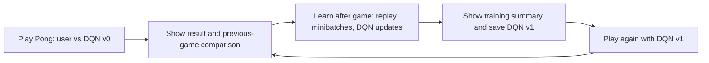

# Pong Learning Lab

**Status: implemented against the v0.2 design and smoke-tested on real two-player
Atari Pong under WSL2. The requirements' formal approval is not yet recorded.**

A live Pong demo where you and a Deep Q-Network control opposing paddles.
After every valid completed game, the machine learns from accumulated gameplay
experience. The UI shows training progress, then lets you play again and compare
the new result with the previous game.

## Review documents

| Document | What to review |
| --- | --- |
| [Architecture](ARCHITECTURE.md) | Two-player game, after-game learning, visual panels, model/replay lifecycle and recovery |
| [Requirements](REQUIREMENTS.md) | Proposed settings, acceptance checks and scope to freeze |
| This README | User journey, what exists and what the new demo adds |

This revision replaces the earlier multi-game, separate-round proposal. To launch
the lab, see [Run the lab on Windows (WSL2)](#run-the-lab-on-windows-wsl2); on
Linux, install `pip install -e ".[env,lab,ui]"` and run `dqn-lab`.

## The demo loop



1. **Play:** choose a new session or compatible saved model. You control one
   paddle; the machine controls the other in the same live match.
2. **Result:** see the outcome, score/return, model version and comparison with
   the previous valid game. The first game establishes the initial record.
3. **Learn:** automatically sample the machine's experience from session replay
   and update its DQN. Show progress, loss, TD error, Q-values and replay size.
4. **Inspect:** see actual updates, before/after diagnostics and the saved model
   version. If there is too little experience, show that honestly and retain the model.
5. **Play again:** continue with the updated learner and retained experience.

A game ends on the environment's termination or a proposed 120-second simulation
cap. A point/rally does not trigger training. Weights stay fixed during play;
updates happen afterward. No annotated dataset is needed: the machine learns from
its own actions and rewards while facing the user.

## Run the lab on Windows (WSL2)

Two-player Atari Pong needs `multi-agent-ale-py`, which has no Windows wheel. A
locally compiled Windows DLL (`scripts/build_windows_atari.py`) is blocked when
Smart App Control is on, so the lab server runs inside WSL2 instead. The browser
UI stays on Windows.

1. One-time, in an administrator PowerShell, then reboot and create the Ubuntu user:

   ```powershell
   wsl --install
   ```

2. One-time setup, from PowerShell in the `DQN` folder (asks for your Ubuntu password):

   ```powershell
   wsl --cd "$PWD" bash scripts/setup_wsl_lab.sh
   ```

3. Start the server and open <http://localhost:8765> in your Windows browser:

   ```powershell
   wsl --cd "$PWD" bash scripts/run_wsl_lab.sh
   ```

The prebuilt UI in `web/dist` is served by the backend. After changing `web/src`,
rebuild it on Windows with `cd web; npm install; npm run build`. Sessions are saved
under `experiments/pong_sessions/`. With the server running, an end-to-end check of
three games, learning and restore is:

```powershell
wsl --cd "$PWD" ~/.venvs/dqn-lab/bin/python scripts/smoke_pong_lab.py
```

## What the UI should show

| Area | Visible information |
| --- | --- |
| Pong canvas | Both paddles, human controls, scoring, timer, active model version and exploration |
| Learning panel | Updates completed, live loss/TD-error/Q charts, replay count, target copies and elapsed time |
| Model summary | Input/output version, checkpoint and fixed-sample before/after diagnostics |
| Last-game comparison | Human/machine score and return, outcome, duration, model version and deltas |
| Session history | Every match and training phase, with observed performance trends |

Game rewards can include serve penalties, so verified goal counts and learning
return are kept distinct. If only returns are available, label the result a return
leader/draw and mark goal/penalty counts unavailable. Better results in a later match are observed performance; the human
opponent and exploration also change. Training is real, but improvement after each
individual game is not guaranteed.

## Implementation and defaults

- Local FastAPI backend plus React/TypeScript/Vite browser UI.
- Two-player Atari Pong adapter using PettingZoo's parallel environment.
- Existing CNN and vanilla DQN learner, uniform replay and a separate target network.
- Replay capacity 20,000 machine transitions; minimum 256 sampleable entries;
  batch size 32; 450 optimizer updates after each eligible match (about one per
  four decisions of a full game); exploration falls from 1.0 to 0.05 over 10,000
  committed decisions, about six full games.
- Preserve replay, optimizer/target state and schedules across games; save a
  versioned model after successful learning and use it in the next match.
- Keep the active model intact if learning fails/cancels; exclude aborted/invalid
  match experience; restore committed between-game state after restart.

These defaults are for the interactive demo and can change during review. The
existing single-agent Pong checkpoint is not automatically compatible with the
new two-player action/observation contract.

## Current status

| Capability | Status |
| --- | --- |
| Atari preprocessing, CNN, replay, DQN learner and checkpoints | Existing Python foundation |
| CLI training/evaluation, sample export, Colab notebook | Existing separate workflows |
| Pygame arena | Existing separate single-agent rounds; no after-game learning |
| Simultaneous user-versus-DQN Pong (`pong_environment.py`) | Implemented; real two-player Atari verified in WSL2 |
| Automatic after-game learning and model-version promotion (`pong_session.py`) | Implemented; unit tested and smoke tested |
| Live learning charts and previous-game comparison (`pong_server.py`, `web/`) | Implemented; UI renders a restored session |
| Between-game session/replay recovery | Implemented; restore verified by the smoke test |

Verification so far: 47 tests pass on Windows and in WSL2.
`scripts/probe_two_player_pong.py` confirms both paddles act, both sides score and
each decision is exactly four emulator frames. `scripts/smoke_pong_lab.py` plays
three scripted games over HTTP/WebSocket (v0 -> v1 -> v2 -> v3) and restores v3
with all six updates. Not yet done: human keyboard play-through, the
REQUIREMENTS acceptance scenarios with the full defaults, and any claim of skill
improvement. Initial play from a random model will be weak; a strong policy
requires enough experience and updates.

## Approval scope

Approval of the requirements would freeze the Pong-only **play -> learn -> play again -> compare** demo, the proposed
defaults and the acceptance checks. The earlier Double DQN, multi-game dashboard,
external-data import and paper-benchmark dashboard are deferred. The new match
protocol is a learning demonstration based on DQN, rather than a direct numerical
reproduction of the paper's single-agent benchmark.

## Existing implementation and commands

The sections below describe the current repository and remain available while
the proposed design is under review. Start/run commands here use existing code.

### A reproduction of the Nature 2015 Deep Q-Network (DQN) paper

## Three-member module allocation

See the [team module guide](modules/README.md) for roles, implementation ownership,
handoff contracts and deliverables:

- Member 1: [dataset and experience generation](modules/01_dataset/README.md).
- Member 2: [training pipeline](modules/02_training/README.md).
- Member 3: [testing and evaluation](modules/03_testing/README.md).
- Shared, led by Member 3: [human-versus-agent UI](modules/04_ui/README.md).

Dataset generation means online gameplay experience and replay storage in this
DQN project. The existing desktop UI supports human/AI score competition on matched rounds.

**Paper:** Volodymyr Mnih et al., *Nature* 518, 529–533 (2015). [Read the paper](https://www.nature.com/articles/nature14236) · [DOI: 10.1038/nature14236](https://doi.org/10.1038/nature14236)

The paper introduced a deep Q-network that learns Atari control directly from pixels and game scores. The authors evaluated one algorithm, architecture, and hyperparameter setting across 49 Atari games, reporting performance comparable to a professional human games tester across the set.

## Atari gameplay showcase

These four reference gameplay clips are retained from the linked implementation and are shown here as visual examples of the Atari tasks. **They are not generated by this project's trained checkpoints.** Attribution and license details are in [`assets/upstream_dqn/ATTRIBUTION.md`](assets/upstream_dqn/ATTRIBUTION.md).

| Atlantis | Boxing |
|---|---|
|  |  |
| Breakout | Pong |
|  |  |

## What this project reproduces

The paper's central method is off-policy Q-learning from image observations. Four recent frames form the state; a convolutional network estimates action values; replay memory reuses past transitions; and a separate target network stabilizes the bootstrap target. The original study trained separate agents on 49 Atari games for 50 million frames with replay memory holding up to one million frames.

This repository implements the visual DQN architecture and learning loop, plus a separate prioritized-replay comparison. It includes a short, matched-seed Breakout experiment for practical comparison and a longer upstream-compatible Breakout profile. The latter ports the linked TensorFlow/Gym implementation to PyTorch/Gymnasium. **This is a reproduction project, not a claim that the paper's full 49-game result has been reproduced.** The local comparison runs use a substantially shorter budget than the paper; see [`docs/experiment_protocol.md`](docs/experiment_protocol.md) and [`docs/upstream_comparison.md`](docs/upstream_comparison.md) for scope and deviations.

## Results from this project

These plots come from this repository's recorded Breakout experiments, not from the paper or the reference GIFs. The comparison uses three seeds per replay method and a 250,000 selected-action training budget per run; it should be read as a small reproduction experiment, not as a replication of the paper's full benchmark.

| Training reward over time | Evaluation score comparison |
|---|---|
|  |  |

Summary data: [`results/metrics/evaluation_summary.csv`](results/metrics/evaluation_summary.csv). The prioritized replay extension is reported separately from the paper's uniform replay baseline.

## DQN model and training details

- **Input:** four stacked 84 × 84 grayscale frames.
- **Network:** three convolutional layers followed by a 512-unit fully connected layer and action-value outputs.
- **Learning:** one-step Bellman targets, Huber loss, gradient clipping, and a periodically updated target network.
- **Experience:** uniform replay for the paper-style baseline; proportional prioritized replay is an optional extension.
- **Atari processing:** action repetition, max pooling over recent frames, image resizing, and frame stacking. The upstream-compatible profile also includes no-op starts, episodic-life boundaries, FIRE reset, and sign-clipped rewards.

See [`assets/upstream_dqn/nn.svg`](assets/upstream_dqn/nn.svg) for the retained network illustration, with source attribution in the asset directory.

## Training pipeline and human/AI UI

See [Atari Lab](docs/atari_lab.md) for the Nature preset and desktop arena, and
the [pipeline guide](docs/pipeline.md) for isolated multi-seed experiments.

```bash
python -m dqn_project.pipeline --config configs/nature.yaml --games Breakout Pong --output experiments/nature-smoke --smoke
python -m dqn_project.play --checkpoint-dir experiments/nature-smoke --games Breakout Pong
```

## Run the project

Create an environment and install the package:

```bash
python3 -m venv .venv
source .venv/bin/activate
python3 -m pip install -e '.[all]'
```

Atari environments require ALE support and ROM access under terms that apply to you. No ROMs are included. Check the environment setup:

```bash
python scripts/environment_smoke_test.py --env ALE/Breakout-v5
```

Run the short uniform-replay baseline or the prioritized-replay comparison:

```bash
dqn-train --config configs/default.yaml
dqn-train --config configs/prioritized.yaml
```

Run the longer upstream-compatible profile on a GPU, or use the Colab notebook to store outputs on Drive:

```bash
dqn-train --config configs/upstream_breakout.yaml
```

[Open the Google Colab notebook](notebooks/07_colab_gpu_breakout.ipynb) · [Notebook instructions](notebooks/README.md)

The upstream-compatible configuration uses a 10-million selected-action budget. It matches the reference implementation's training behavior and Atari data pipeline as closely as this PyTorch/Gymnasium port allows; random streams, framework behavior, and scores can differ. Periodic checkpoints save model and optimizer state but omit replay and environment state, so an interrupted run cannot be resumed exactly.

Evaluate a saved checkpoint or random policy:

```bash
dqn-evaluate --config configs/default.yaml \
  --checkpoint checkpoints/breakout_uniform_seed7_final.pt \
  --output results/metrics/uniform_evaluation.json

dqn-evaluate --config configs/default.yaml --random-baseline \
  --output results/metrics/random_evaluation.json
```

Run the local test suite:

```bash
python -m unittest discover -s tests -v
```

## Repository map

- `src/dqn_project/` — model, learner, Atari preprocessing, replay, training, and evaluation.
- `configs/` — uniform, prioritized, and upstream-compatible training profiles.
- `notebooks/` — Colab workflow for GPU training, evaluation, and media export.
- `results/` — recorded experiment metrics, plots, and report artifacts.
- `docs/` — paper comparison, experiment protocol, architecture notes, and data pipeline.
- `assets/upstream_dqn/` — attributed visual references from the linked implementation.

## Citation

```bibtex
@article{mnih2015humanlevel,
  title   = {Human-level control through deep reinforcement learning},
  author  = {Mnih, Volodymyr and Kavukcuoglu, Koray and Silver, David and others},
  journal = {Nature},
  volume  = {518},
  pages   = {529--533},
  year    = {2015},
  doi     = {10.1038/nature14236}
}
```
