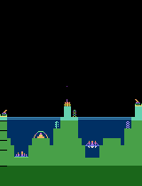
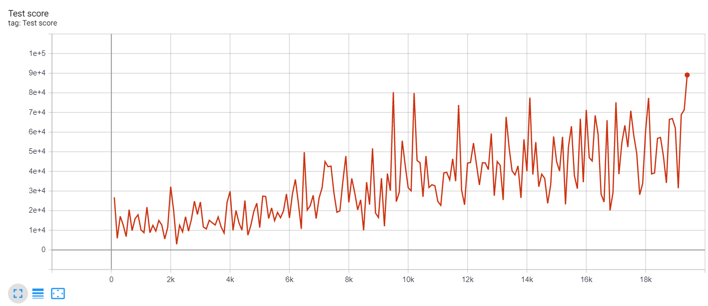
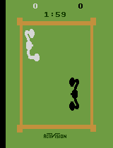
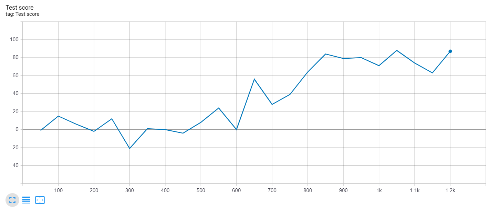
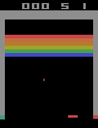
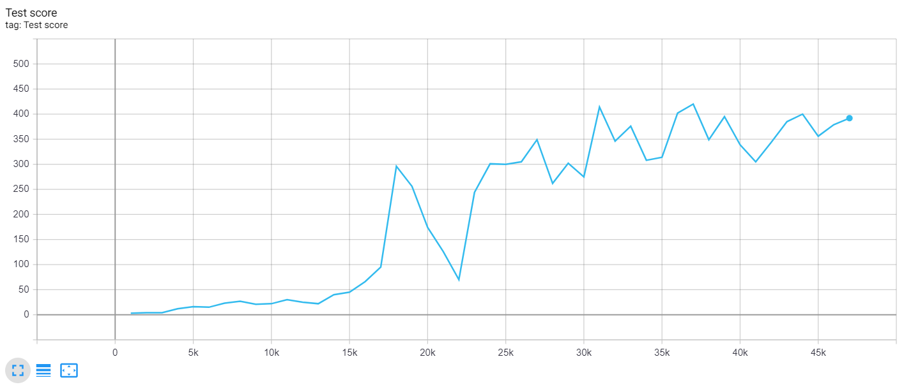
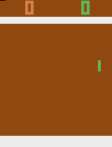
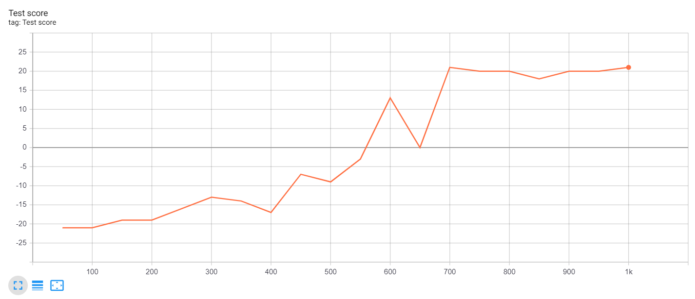

# DQN reproduction project

This repository implements the core Deep Q-Network (DQN) algorithm described by
Mnih et al. (2015), plus a clearly separated proportional prioritized-experience-
replay extension. It is scoped as a course reproduction: the code follows the paper's
visual architecture and learning mechanics, while the default experiment uses a much
smaller compute and replay budget than the original 49-game, 50-million-frame study.

## What is implemented

- 84 x 84 x 4 visual input, three convolutional layers, 512-unit hidden layer.
- Separate online and target Q-networks, one-step Bellman targets, Huber loss,
  RMSProp, gradient clipping, checkpoint save/load.
- Atari-style luminance resize, two-frame max pooling, action repeat of four and
  four-frame stacking.
- Epsilon-greedy exploration and uniform circular replay.
- Optional proportional prioritized replay with importance-sampling weights.
- CSV metrics, checkpoint evaluation, random baseline, plots and summary tables.
- Unit and integration tests for the agreed interfaces.

## Quick start

Create an isolated Python environment, then install the package:

```bash
python3 -m venv .venv
source .venv/bin/activate
python3 -m pip install -e '.[all]'
```

Current Gymnasium/ALE releases install Atari support through the `atari` extra and
register ALE explicitly at runtime. No ROMs are stored in this repository; use Atari
content only under terms that apply to you. Verify the installation before training:

```bash
python scripts/environment_smoke_test.py --env ALE/Breakout-v5
```

Run the local test suite (no Gymnasium or ROM required):

```bash
python -m unittest discover -s tests -v
```

Train the comparable uniform and prioritized configurations:

```bash
dqn-train --config configs/default.yaml
dqn-train --config configs/prioritized.yaml
```

Evaluate saved agents and the random baseline with the same episode protocol:

```bash
dqn-evaluate --config configs/default.yaml \
  --checkpoint checkpoints/breakout_uniform_seed7_final.pt \
  --output results/metrics/uniform_evaluation.json
dqn-evaluate --config configs/default.yaml --random-baseline \
  --output results/metrics/random_evaluation.json
```

Plot only actual recorded logs:

```bash
dqn-plot results/metrics/breakout_uniform_seed7.csv \
  results/metrics/breakout_prioritized_seed7.csv \
  --output results/plots/training_reward.png
```

## Repository map

- `src/dqn_project/`: model, learner, agent, environment, replay, training,
  evaluation and plotting code.
- `configs/`: matched uniform/prioritized experiment definitions.
- `tests/`: fast tests using synthetic tensors and a fake image environment.
- `docs/SPEC.md`: binding interface contract and acceptance checklist.
- `docs/experiment_protocol.md`: experiment design, logging schema and deviations.
- `docs/architecture_notes.md`: concise explanation of the DQN method.
- `docs/upstream_comparison.md`: exact implementation differences from the linked
  GitHub reproduction.
- `assets/upstream_dqn/`: attributed reference GIFs, plots and network diagram from
  that repository; these do not depict this project's runs.
- `results/`: generated metrics and plots; placeholder directories are tracked.

## Visual references from the linked repository

The following are upstream examples, not assets generated by this project. See
[`assets/upstream_dqn/ATTRIBUTION.md`](assets/upstream_dqn/ATTRIBUTION.md) and the
retained MIT license before redistribution. The full gallery is collapsed by default
because the original animated GIFs are large.

<details>
<summary>Show the upstream gameplay GIFs and result plots</summary>

| Upstream gameplay GIF | Upstream repository result plot |
|---|---|
| Atlantis<br> | Atlantis<br> |
| Boxing<br> | Boxing<br> |
| Breakout<br> | Breakout<br> |
| Pong<br> | Pong<br> |

</details>

The upstream network illustration is [`nn.svg`](assets/upstream_dqn/nn.svg). Its
README also links to the [original paper demonstration video on YouTube](https://www.youtube.com/watch?v=TmPfTpjtdgg); the video is linked, not copied into this repository.

Do not commit ROMs, credentials, large checkpoints, or invented results. A positive
prioritized-replay claim requires matched seeds/budgets and completed evaluations.
