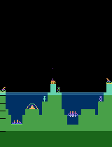
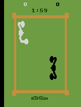
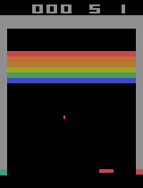
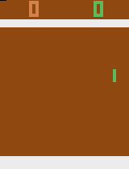
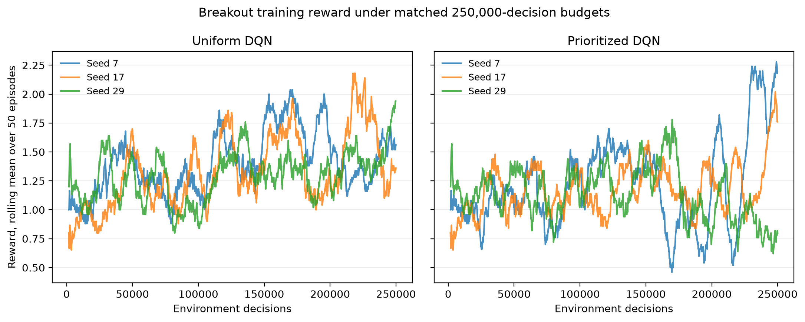
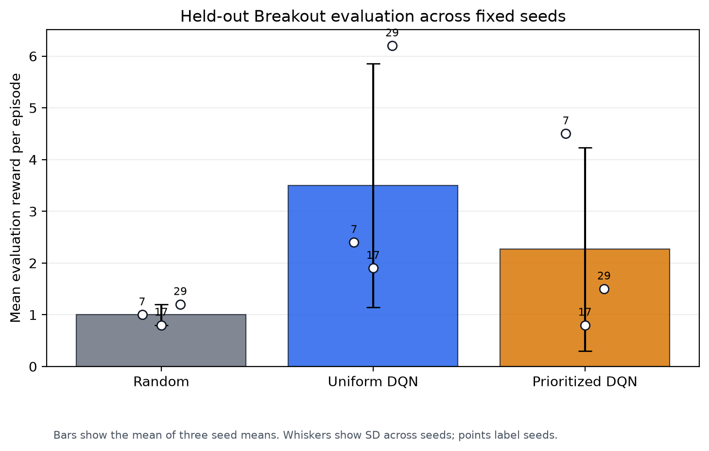

# Human-level control through deep reinforcement learning

### A reproduction of the Nature 2015 Deep Q-Network (DQN) paper

**Paper:** Volodymyr Mnih et al., *Nature* 518, 529–533 (2015). [Read the paper](https://www.nature.com/articles/nature14236) · [DOI: 10.1038/nature14236](https://doi.org/10.1038/nature14236)

The paper introduced a deep Q-network that learns Atari control directly from pixels and game scores. The authors evaluated one algorithm, architecture, and hyperparameter setting across 49 Atari games, reporting performance comparable to a professional human games tester across the set.

## Atari gameplay showcase

These four reference gameplay clips are retained from the linked implementation and are shown here as visual examples of the Atari tasks. **They are not generated by this project's trained checkpoints.** Attribution and license details are in [`assets/upstream_dqn/ATTRIBUTION.md`](assets/upstream_dqn/ATTRIBUTION.md).

| Atlantis | Boxing |
|---|---|
|  |  |
| Breakout | Pong |
|  |  |

## What this project reproduces

The paper's central method is off-policy Q-learning from image observations. Four recent frames form the state; a convolutional network estimates action values; replay memory reuses past transitions; and a separate target network stabilizes the bootstrap target. The original study trained separate agents on 49 Atari games for 50 million frames with replay memory holding up to one million frames.

This repository implements the visual DQN architecture and learning loop, plus a separate prioritized-replay comparison. It includes a short, matched-seed Breakout experiment for practical comparison and a longer upstream-compatible Breakout profile. The latter ports the linked TensorFlow/Gym implementation to PyTorch/Gymnasium. **This is a reproduction project, not a claim that the paper's full 49-game result has been reproduced.** The local comparison runs use a substantially shorter budget than the paper; see [`docs/experiment_protocol.md`](docs/experiment_protocol.md) and [`docs/upstream_comparison.md`](docs/upstream_comparison.md) for scope and deviations.

## Results from this project

These plots come from this repository's recorded Breakout experiments, not from the paper or the reference GIFs. The comparison uses three seeds per replay method and a 250,000 selected-action training budget per run; it should be read as a small reproduction experiment, not as a replication of the paper's full benchmark.

| Training reward over time | Evaluation score comparison |
|---|---|
|  |  |

Summary data: [`results/metrics/evaluation_summary.csv`](results/metrics/evaluation_summary.csv). The prioritized replay extension is reported separately from the paper's uniform replay baseline.

## DQN model and training details

- **Input:** four stacked 84 × 84 grayscale frames.
- **Network:** three convolutional layers followed by a 512-unit fully connected layer and action-value outputs.
- **Learning:** one-step Bellman targets, Huber loss, gradient clipping, and a periodically updated target network.
- **Experience:** uniform replay for the paper-style baseline; proportional prioritized replay is an optional extension.
- **Atari processing:** action repetition, max pooling over recent frames, image resizing, and frame stacking. The upstream-compatible profile also includes no-op starts, episodic-life boundaries, FIRE reset, and sign-clipped rewards.

See [`assets/upstream_dqn/nn.svg`](assets/upstream_dqn/nn.svg) for the retained network illustration, with source attribution in the asset directory.

## Run the project

Create an environment and install the package:

```bash
python3 -m venv .venv
source .venv/bin/activate
python3 -m pip install -e '.[all]'
```

Atari environments require ALE support and ROM access under terms that apply to you. No ROMs are included. Check the environment setup:

```bash
python scripts/environment_smoke_test.py --env ALE/Breakout-v5
```

Run the short uniform-replay baseline or the prioritized-replay comparison:

```bash
dqn-train --config configs/default.yaml
dqn-train --config configs/prioritized.yaml
```

Run the longer upstream-compatible profile on a GPU, or use the Colab notebook to store outputs on Drive:

```bash
dqn-train --config configs/upstream_breakout.yaml
```

[Open the Google Colab notebook](notebooks/07_colab_gpu_breakout.ipynb) · [Notebook instructions](notebooks/README.md)

The upstream-compatible configuration uses a 10-million selected-action budget. It matches the reference implementation's training behavior and Atari data pipeline as closely as this PyTorch/Gymnasium port allows; random streams, framework behavior, and scores can differ. Periodic checkpoints save model and optimizer state but omit replay and environment state, so an interrupted run cannot be resumed exactly.

Evaluate a saved checkpoint or random policy:

```bash
dqn-evaluate --config configs/default.yaml \
  --checkpoint checkpoints/breakout_uniform_seed7_final.pt \
  --output results/metrics/uniform_evaluation.json

dqn-evaluate --config configs/default.yaml --random-baseline \
  --output results/metrics/random_evaluation.json
```

Run the local test suite:

```bash
python -m unittest discover -s tests -v
```

## Repository map

- `src/dqn_project/` — model, learner, Atari preprocessing, replay, training, and evaluation.
- `configs/` — uniform, prioritized, and upstream-compatible training profiles.
- `notebooks/` — Colab workflow for GPU training, evaluation, and media export.
- `results/` — recorded experiment metrics, plots, and report artifacts.
- `docs/` — paper comparison, experiment protocol, architecture notes, and data pipeline.
- `assets/upstream_dqn/` — attributed visual references from the linked implementation.

## Citation

```bibtex
@article{mnih2015humanlevel,
  title   = {Human-level control through deep reinforcement learning},
  author  = {Mnih, Volodymyr and Kavukcuoglu, Koray and Silver, David and others},
  journal = {Nature},
  volume  = {518},
  pages   = {529--533},
  year    = {2015},
  doi     = {10.1038/nature14236}
}
```
