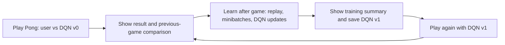

# Pong Learning Lab: full guide

This page holds the detailed design, setup, and status for the two-player Pong demo. For the project overview, see the [root README](../README.md).

**Status: implemented against the v0.2 design and smoke-tested on real two-player
Atari Pong under WSL2. The requirements' formal approval is not yet recorded.**

A live Pong demo where you and a Deep Q-Network control opposing paddles.
After every valid completed game, the machine learns from accumulated gameplay
experience. The UI shows training progress, then lets you play again and compare
the new result with the previous game.

## Review documents

| Document | What to review |
| --- | --- |
| [Architecture](../ARCHITECTURE.md) | Two-player game, after-game learning, visual panels, model/replay lifecycle and recovery |
| [Requirements](../REQUIREMENTS.md) | Proposed settings, acceptance checks and scope to freeze |
| This README | User journey, what exists and what the new demo adds |

This revision replaces the earlier multi-game, separate-round proposal. To launch
the lab, see [Run the Pong Learning Lab UI](#run-the-pong-learning-lab-ui); on
Linux, install `pip install -e ".[env,lab,ui]"` and run `dqn-lab`.

## The demo loop



1. **Play:** choose a new session or compatible saved model. You control one
   paddle; the machine controls the other in the same live match.
2. **Result:** see the outcome, score/return, model version and comparison with
   the previous valid game. The first game establishes the initial record.
3. **Learn:** automatically sample the machine's experience from session replay
   and update its DQN. Show progress, loss, TD error, Q-values and replay size.
4. **Inspect:** see actual updates, before/after diagnostics and the saved model
   version. If there is too little experience, show that honestly and retain the model.
5. **Play again:** continue with the updated learner and retained experience.

A game ends on the environment's termination or a proposed 120-second simulation
cap. A point/rally does not trigger training. Weights stay fixed during play;
updates happen afterward. No annotated dataset is needed: the machine learns from
its own actions and rewards while facing the user.

## Run the Pong Learning Lab UI

**Quick start** (after the one-time setup below). Open PowerShell in the `DQN`
folder and run:

```powershell
wsl bash scripts/run_wsl_lab.sh
```

When it prints `Pong Learning Lab: open http://localhost:8765`, open
<http://localhost:8765> in your normal Windows browser. Keep that PowerShell window
open while you play; press **Ctrl+C** in it to stop the server.

### Why WSL2 on Windows

Two-player Atari Pong needs `multi-agent-ale-py`, which has no Windows wheel. A
locally compiled Windows DLL (`scripts/build_windows_atari.py`) is blocked when
Smart App Control is on, so the lab server runs inside WSL2 (Linux). The browser
stays on Windows; WSL2 forwards `localhost:8765` automatically.

### One-time setup

1. **Install WSL2.** In an administrator PowerShell run the command below, reboot,
   then open **Ubuntu** from the Start menu once to create your Linux username and
   password.

   ```powershell
   wsl --install
   ```

2. **Install the lab environment.** From PowerShell in the `DQN` folder:

   ```powershell
   wsl bash scripts/setup_wsl_lab.sh
   ```

   This creates a Linux virtual environment at `~/.venvs/dqn-lab` (your Windows
   `.venv` is untouched), installs PyTorch and the lab dependencies, builds the
   two-player Atari runtime and ends with `multi-agent-ale-py loaded; pong_v3 import OK`.
   If system packages are missing it runs `sudo apt-get` and asks for your Ubuntu
   password.

   **GPU:** when an NVIDIA GPU is visible in WSL (`wsl nvidia-smi` works; Windows
   driver 560 or newer), the script installs the CUDA 12.6 build of PyTorch and the
   lab trains on the GPU automatically. To switch an existing CPU install to CUDA:

   ```powershell
   wsl bash -c 'mkdir -p ~/.cache/piptmp && TMPDIR=~/.cache/piptmp ~/.venvs/dqn-lab/bin/python -m pip install "torch==2.14.1+cu126" --index-url https://download.pytorch.org/whl/cu126 && rm -rf ~/.cache/piptmp'
   ```

   (`TMPDIR` matters: WSL's `/tmp` is a small RAM disk and the CUDA wheels need
   several GB to unpack.)

3. **Build the browser UI** (needs [Node.js](https://nodejs.org/) on Windows; only
   again after changing `web/src`):

   ```powershell
   cd web; npm install; npm run build; cd ..
   ```

   The server serves the built files from `web/dist`.

### Playing

1. Press **Create session**. The defaults are a 120-second game, 450 learning
   updates after each game and the **Nature DQN** network. The **Network** menu
   also offers **Dueling DQN**: the same convolutional layers, with the head split
   into a state value V(s) and per-action advantages A(s, a), combined as
   Q = V + A − mean(A). A session keeps the network it was created with.
2. Press **Start match**. You control the **left** paddle; the DQN controls the right one.

   | Key | Action |
   | --- | --- |
   | ↑ or W | Move up |
   | ↓ or S | Move down |
   | Space | Serve |
   | Esc | Abort the game (no learning from it) |

   Keep the browser tab focused: switching away releases your keys and aborts the game.
3. After the game the machine learns automatically (450 updates: about 6 s for
   Nature and 7 s for Dueling on an RTX 3050 laptop GPU; about 28–40 s on CPU), then shows
   the learning charts, the new model version and the comparison with your last game.
   Press **Play again** to face the updated model.

Expect weak play at first: the machine explores randomly until about six full games
in, and needs dozens of games before it clearly tracks the ball. The machine decides
15 times per second (every four emulator frames, as in the DQN paper); a GPU speeds
up learning between games, not reactions during play.

**Resuming a session.** After every completed game and learning phase the model,
optimizer, replay buffer and counters are saved under `experiments/pong_sessions/`.
To continue later, open **New / restore session**, pick the session from
**Restore a saved session…** (listed newest first with its network, model version
and number of games) and press **Restore**. A game that was interrupted is not
saved; the session resumes from the last completed game. A restored session uses
the GPU when one is available.

### On Linux or macOS

No WSL is needed. From the `DQN` folder:

```bash
python3 -m venv .venv && source .venv/bin/activate
pip install -e ".[env,lab,ui]" websockets
dqn-lab
```

Then build the UI as in step 3 (`cd web && npm install && npm run build`) and open
<http://localhost:8765>.

### Check that everything works

With the server running, this plays three short scripted games over the real API,
checks that the model version advances after each one and that the session restores:

```powershell
wsl ~/.venvs/dqn-lab/bin/python scripts/smoke_pong_lab.py
```

Run the test suite inside WSL with `wsl ~/.venvs/dqn-lab/bin/python -m pytest -q`.

### Troubleshooting

| Problem | Fix |
| --- | --- |
| `Build the UI first` in the browser | Run step 3, then reload the page. |
| `No lab environment at ~/.venvs/dqn-lab` | Run the one-time setup, step 2. |
| Port 8765 already in use | A server is already running; use it, or stop it with Ctrl+C. To use another port: `wsl bash scripts/run_wsl_lab.sh --port 8800`. |
| `apt-get`: Release file `is not valid yet` | The Windows clock or timezone is wrong. Fix it in Windows Settings › Time & language, then run `wsl --shutdown` and retry. |
| Page does not load from Windows | Check the server window shows no error, then try <http://127.0.0.1:8765>. |

## What the UI should show

| Area | Visible information |
| --- | --- |
| Pong canvas | Both paddles, human controls, scoring, timer, active model version and exploration |
| Learning panel | Updates completed, live loss/TD-error/Q charts, replay count, target copies and elapsed time |
| Model summary | Input/output version, checkpoint and fixed-sample before/after diagnostics |
| Last-game comparison | Human/machine score and return, outcome, duration, model version and deltas |
| Session history | Every match and training phase, with observed performance trends |

Game rewards can include serve penalties, so verified goal counts and learning
return are kept distinct. If only returns are available, label the result a return
leader/draw and mark goal/penalty counts unavailable. Better results in a later match are observed performance; the human
opponent and exploration also change. Training is real, but improvement after each
individual game is not guaranteed.

## Implementation and defaults

- Local FastAPI backend plus React/TypeScript/Vite browser UI.
- Two-player Atari Pong adapter using PettingZoo's parallel environment.
- Existing CNN and vanilla DQN learner, uniform replay and a separate target network.
- Replay capacity 20,000 machine transitions; minimum 256 sampleable entries;
  batch size 32; 450 optimizer updates after each eligible match (about one per
  four decisions of a full game); exploration falls from 1.0 to 0.05 over 10,000
  committed decisions, about six full games.
- Preserve replay, optimizer/target state and schedules across games; save a
  versioned model after successful learning and use it in the next match.
- Keep the active model intact if learning fails/cancels; exclude aborted/invalid
  match experience; restore committed between-game state after restart.

These defaults are for the interactive demo and can change during review. The
existing single-agent Pong checkpoint is not automatically compatible with the
new two-player action/observation contract.

## Current status

| Capability | Status |
| --- | --- |
| Atari preprocessing, CNN, replay, DQN learner and checkpoints | Existing Python foundation |
| CLI training/evaluation, sample export, Colab notebook | Existing separate workflows |
| Pygame arena | Existing separate single-agent rounds; no after-game learning |
| Simultaneous user-versus-DQN Pong (`pong_environment.py`) | Implemented; real two-player Atari verified in WSL2 |
| Automatic after-game learning and model-version promotion (`pong_session.py`) | Implemented; unit tested and smoke tested |
| Live learning charts and previous-game comparison (`pong_server.py`, `web/`) | Implemented; UI renders a restored session |
| Between-game session/replay recovery | Implemented; restore verified by the smoke test |

Verification so far: 47 tests pass on Windows and in WSL2.
`scripts/probe_two_player_pong.py` confirms both paddles act, both sides score and
each decision is exactly four emulator frames. `scripts/smoke_pong_lab.py` plays
three scripted games over HTTP/WebSocket (v0 -> v1 -> v2 -> v3) and restores v3
with all six updates. Not yet done: human keyboard play-through, the
REQUIREMENTS acceptance scenarios with the full defaults, and any claim of skill
improvement. Initial play from a random model will be weak; a strong policy
requires enough experience and updates.

## Approval scope

Approval of the requirements would freeze the Pong-only **play -> learn -> play again -> compare** demo, the proposed
defaults and the acceptance checks. The earlier Double DQN, multi-game dashboard,
external-data import and paper-benchmark dashboard are deferred. The new match
protocol is a learning demonstration based on DQN, rather than a direct numerical
reproduction of the paper's single-agent benchmark.

